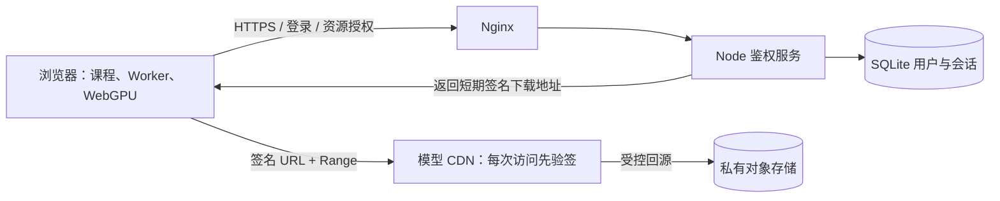
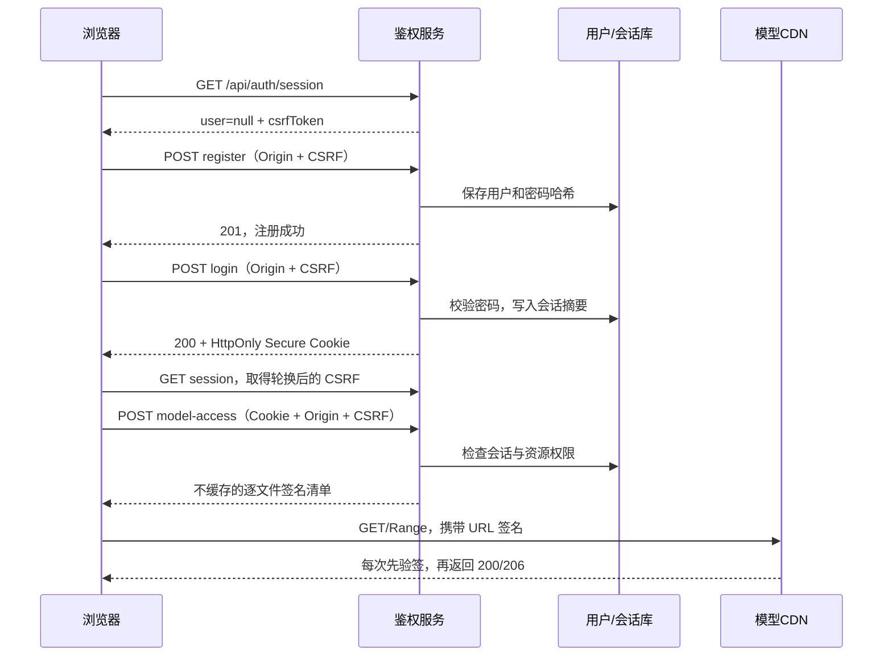

# LLM 教学平台技术实施文档

版本：1.0  
日期：2026-10-25  
对应项目：`how-llms-work`  
适用人员：后端开发、前端开发、运维及项目负责人  
文档性质：生产部署实施方案；配置示例需替换域名、证书路径及云服务参数后在预发布环境验证。

## 1. 实施范围与现状

平台包含中英文交互式课程、注册登录、浏览器端 WebGPU 模型推理、Worker 与 WASM 运行资源。推荐采用“小型鉴权服务器 + 对象存储 + CDN”的架构，服务器无需 GPU。主要下载流量来自模型权重，模型运算消耗用户设备的 GPU 与内存。

本文以现有代码为基线。服务器配置、容量与超时等数值属于初始工程建议，未经生产压力测试，不构成并发承诺。协议行为引用官方文档，具体 CDN 参数仍需按选定厂商验证。

| 项目 | 当前状态 | 生产实施要求 |
|---|---|---|
| 注册、登录、退出 | 已实现并完成本地验收 | 保留现有流程，补充生产监控及限流 |
| 密码及会话存储 | SQLite、scrypt、会话摘要 | 持久卷、备份、恢复演练 |
| 课程与模型鉴权 | 本地 Node 服务统一拦截 | CDN 缓存命中时也必须执行访问授权 |
| 模型文件 | 本地完整 BF16 权重；支持 Range | 上传自有私有对象存储，配置 CDN |
| 模型缺失处理 | 回源参考站下载 | 上线时禁用参考站兜底，使用自有资源 |
| HTTPS | 当前为 localhost HTTP | 域名、证书、HTTPS 反向代理 |
| CDN 下载凭证 | 尚未实现 | 新增资源授权接口与前端下载适配 |
| 邮箱验证、找回密码 | 尚未实现 | 按开放注册需求补充；邮箱目前仅是账户标识 |
| 模型实际回答 | 初始化及文件检查已完成 | 完整生成回答与 J-Space 实时结果仍须验收 |

当前复用了原站公开发布的压缩前端产物，未获得原始 React/TypeScript 工程。CDN 下载改造应先定位并验证真实资源加载调用；长期维护宜迁移至可维护源码。公开上线前应确认课程、前端产物及模型的适用使用与分发授权。

## 2. 推荐架构与域名

域名示例采用保留域名 `example.com`，部署时统一替换。

| 域名或地址 | 服务职责 | 数据与访问要求 |
|---|---|---|
| `https://learn.example.com` | 登录页、课程入口、同源 API | HTTPS；账户接口禁止共享缓存 |
| `127.0.0.1:5173` | Node 服务 | 仅允许本机 Nginx 访问 |
| `https://models.example.com` | CDN 模型下载 | 下载请求必须通过签名校验 |
| 私有对象存储桶 | 模型、分词器、配置文件 | 仅 CDN 的受控回源身份可读取 |
| `/var/lib/how-llms-work` | 用户、会话数据库 | 不属于静态发布目录 |



提示词与模型生成发生在浏览器中；本方案不增加云端推理接口。前端错误日志应过滤提示词、密码、Cookie 及下载签名。

第一阶段保留课程、脚本、Worker、WASM 在主站同源，避免一次性改动运行环境。优先把体积最大的模型迁至 CDN。第二阶段再将课程运行资源迁至同一主站域名下的 CDN 路由或受保护资源域名。若课程内容必须登录才能获取，不得把含课程内容的 JS 包直接公开到公共 CDN。

## 3. 服务器配置与容量规划

### 3.1 起步配置

| 项目 | 小规模试运行建议 | 扩容依据 |
|---|---|---|
| CPU | 2 vCPU | 登录时密码哈希耗时、CPU 持续占用 |
| 内存 | 2 GB 起步；4 GB 可留更多余量 | Node RSS、哈希并发、系统剩余内存 |
| 磁盘 | 20 GB SSD 起步 | 系统、发布版本、日志、数据库及备份占用 |
| GPU | 不需要 | 如增加云端推理，应另设推理服务 |
| 系统 | 受支持的 Linux LTS 发行版 | 与 Node、Nginx、运维工具兼容 |
| Node | 项目最低要求 22.13；建议固定经过验证的受支持 LTS 版本 | 验证 `node:sqlite` 可用性及版本警告 |
| 数据库 | 单机 SQLite WAL | 多实例、写竞争、可用性要求上升时迁移 |
| 带宽 | API 和网页流量按实测配置 | 模型经 CDN 直传，不经过 Node 中转 |

2 vCPU / 2 GB 是采购起点。当前 SQLite 使用同步接口，密码计算使用异步 scrypt；登录高峰会消耗 CPU 和哈希任务内存，应压测后设置并发上限。多核不能自动提升单进程同步数据库吞吐。

20 GB 不包含长期保留大量模型版本的空间。采用 CDN 后，主机可不保存生产模型；若保留本地回退模型，必须额外计入完整模型及版本备份。

### 3.2 模型流量估算

当前 `model.safetensors` 精确大小为 **1,706,030,600 字节**，约 1.706 GB（十进制）或 1.589 GiB（二进制）。其他配置、分词器、WASM 与网页资源另计。以下是假定每人完整下载一次权重的数学估算，不是实际运营数据。

| 完整权重下载次数 | CDN 下行权重流量，十进制 |
|---|---|
| 100 次 | 170.603 GB |
| 1,000 次 | 1,706.031 GB，约 1.706 TB |

此前“100 人约 160 GB”是粗略量级表达，正式预算应采用上述文件大小及统一单位。浏览器缓存复用、失败重试、Range 重复、模型升级均会改变实际流量。CDN 命中减少对象存储回源，不会免除 CDN 对用户的下行流量。

预算公式：服务器固定费用 + CDN 实际计费流量 × 单价 + 对象存储容量及请求费用 + 回源费用 + 日志与备份费用。未选厂商、地区和套餐前，不填写金额或固定并发能力。

## 4. 主机部署与 HTTPS

### 4.1 目录、进程与环境变量

推荐安装结构：

```text
/opt/how-llms-work/releases/<release-id>/    每次发布的只读程序及网页
/opt/how-llms-work/current                 指向当前发布的软链接
/var/lib/how-llms-work/auth.sqlite         持久账号数据库
/var/lib/how-llms-work/model/              可选本地模型回退目录
/var/backups/how-llms-work/                备份临时落盘目录
/etc/how-llms-work.env                     服务环境变量
```

使用专用非登录账户 `llmapp` 运行 Node；程序目录只读，数据目录由该账户拥有且权限为 0700，数据库为 0600。备份目录也须受限。SQLite 的 WAL/SHM 文件必须可写；部署时不要只给数据库文件写权限。

当前支持的环境变量如下，不应把尚未实现的 CDN 参数误当成现有功能。

```dotenv
PORT=5173
PUBLIC_ORIGIN=https://learn.example.com
AUTH_DATA_DIR=/var/lib/how-llms-work
MODEL_DIR=/var/lib/how-llms-work/model
NODE_ENV=production
```

`PUBLIC_ORIGIN` 必须为用户实际访问的 HTTPS origin，不包含尾部斜杠或路径。它用于精确 Origin 校验及 Secure Cookie。`NODE_ENV` 是部署约定，当前代码没有据此自动禁用参考站模型回源。

后续拟新增参数：`MODEL_CDN_ORIGIN`、`MODEL_RELEASE`、`CDN_SIGNING_KEY_ID`、`CDN_SIGNING_PRIVATE_KEY_FILE`、`MODEL_URL_TTL_SECONDS`、可信代理配置。名称与实现应一同提交；签名私钥仅保留在服务端或密钥服务，不写入前端包、仓库或公开存储。

### 4.2 systemd 模板

下列模板以 `/usr/bin/node` 为安装路径；使用其他路径时替换。应用账户、环境文件、目录和发布软链接需先准备完成。

```ini
[Unit]
Description=How LLMs Work application
After=network.target

[Service]
Type=simple
User=llmapp
Group=llmapp
WorkingDirectory=/opt/how-llms-work/current
EnvironmentFile=/etc/how-llms-work.env
ExecStart=/usr/bin/node /opt/how-llms-work/current/server.mjs
Restart=on-failure
RestartSec=3
UMask=0077
NoNewPrivileges=true
PrivateTmp=true
ProtectSystem=strict
ProtectHome=true
ReadWritePaths=/var/lib/how-llms-work
StandardOutput=journal
StandardError=journal

[Install]
WantedBy=multi-user.target
```

安装为 `/etc/systemd/system/how-llms-work.service` 后执行：

```bash
sudo systemctl daemon-reload
sudo systemctl enable --now how-llms-work
sudo systemctl status how-llms-work
curl --fail http://127.0.0.1:5173/health
```

当前无第三方 npm 运行依赖；发布时携带 `server.mjs`、`auth.mjs`、`auth-ui/`、`index.html`、`assets/`、WASM 和版本记录。`/health` 只检查进程响应和本地模型是否存在，不能替代数据库、CDN、推理的完整就绪检查。

### 4.3 Nginx 起步模板

模板将所有主站请求交由现有服务鉴权，保留 127.0.0.1 监听。证书需事先签发并配置自动续期。配置不直接通过 Nginx 静态目录暴露课程或模型。

```nginx
server {
    listen 80;
    server_name learn.example.com;
    return 301 https://learn.example.com$request_uri;
}

server {
    listen 443 ssl;
    server_name learn.example.com;

    ssl_certificate /etc/letsencrypt/live/learn.example.com/fullchain.pem;
    ssl_certificate_key /etc/letsencrypt/live/learn.example.com/privkey.pem;
    ssl_protocols TLSv1.2 TLSv1.3;
    client_max_body_size 8k;

    add_header Strict-Transport-Security "max-age=31536000" always;

    location / {
        proxy_pass http://127.0.0.1:5173;
        proxy_http_version 1.1;
        proxy_set_header Host $host;
        proxy_set_header X-Forwarded-Proto https;
        proxy_set_header X-Forwarded-For $remote_addr;
        proxy_set_header X-Real-IP $remote_addr;
        proxy_connect_timeout 5s;
        proxy_read_timeout 120s;
        proxy_buffering off;
        proxy_cache off;
    }
}
```

这里由 Nginx覆盖客户端转发头，适用于浏览器直接连接 Nginx 的拓扑。若主站前还有 CDN，应先配置并限制可信 CDN 来源，再按厂商真实 IP 机制恢复客户端地址，不能直接信任任意请求携带的 IP 头。

**上线前必须修改 `auth.mjs` 的 IP 识别。** 当前读取 `req.socket.remoteAddress`，反代后所有访问会被识别为代理地址，导致多人共享 15 分钟请求额度。Node 仅在 socket 来源属于可信代理时读取由该代理覆盖的客户端 IP 头。上述 Nginx 配置本身不会修复应用限流。

防火墙开放 80/443，管理端口限管理来源；5173 不对公网开放。生产模型走 CDN，若暂时保留主站大文件下载，应单独调整下载超时并验证断点续传。

当前 Node 已发送 COOP、COEP、CORP；Nginx 不重复添加这些头。迁移静态内容到 Nginx/CDN 后，对新响应路径补齐相同策略，避免重复同名策略头。[cite:1]

## 5. 对象存储与 CDN 设置

### 5.1 对象发布和私有回源

按不可变版本上传资源：

```text
/models/qwen3.5-0.8b-bf16/<release-id>/config.json
/models/qwen3.5-0.8b-bf16/<release-id>/tokenizer.json
/models/qwen3.5-0.8b-bf16/<release-id>/model.safetensors
```

上述为目录规则示例；实际上线应以本地模型目录和运行时请求清单为准，将所有所需 tokenizer、配置和辅助文件完整发布。禁止只上传权重后依赖原站补齐文件。

实施顺序：

1. 统计实际资源清单，记录路径、字节数及 SHA-256，生成发布清单。
2. 创建私有对象存储桶，关闭匿名读和目录列表。
3. 上传版本目录，核对对象大小和哈希，禁止原路径覆盖更新。
4. 配置 CDN 受控回源身份，仅授权读取指定资源前缀。
5. CDN 对模型 GET/HEAD 设置签名校验；裸 URL 与直连存储 URL 均须拒绝。
6. 对错误响应、HEAD、Range 和预检逐一验证；最后切换授权接口指向新版本。

对象存储 ETag 不一定是文件 MD5，尤其是多段上传；完整性验证使用自建 SHA-256 发布清单。生产禁止把缺失资源静默回退到参考站。

### 5.2 缓存与鉴权规则

| 资源 | 浏览器缓存 | CDN 缓存 | 授权规则 |
|---|---|---|---|
| `/api/auth/*`、账户数据、签名清单 | `no-store` | 完全绕过；不缓存 Set-Cookie | 按接口校验会话、CSRF |
| 当前受保护课程 HTML | `private, no-store` | 第一阶段绕过 | 每次请求检查会话 |
| 登录 UI 的公共文件 | 可按版本短期或长期缓存 | 可缓存 | 不携带用户信息 |
| 课程 JS、Worker、WASM | 第一阶段保持现状 | 后续可缓存不可变版本 | 若课程保密，每次请求含缓存命中都先授权 |
| 不可变模型文件 | 推荐 `private, max-age=0, no-store` | 经边缘授权后内部长期缓存 | 每次 GET/HEAD 先验签再查缓存 |

模型使用 CDN 内部缓存策略将对象 TTL 初始设置为 30 天；该数值是建议值。可使用厂商缓存规则或支持的专用缓存指令，让边缘缓存与浏览器缓存策略分别生效。必须验证厂商是否支持覆盖浏览器 `private/no-store` 所对应的回源策略，不能仅设置浏览器响应头后假定 CDN 一定缓存。

下载签名参数可从缓存键中排除以提升共享对象命中率，前提是使用 CDN 原生私有内容机制或已验证的边缘授权，并且**缓存命中之前仍执行验签**。不同厂商的验签顺序、查询参数及 Range 缓存机制不完全相同，禁止简单“忽略全部 query 参数”后让裸地址命中受保护缓存。

不把会话 Cookie 加入公共模型缓存键，不将应用 Cookie 转发到模型对象存储。多个 origin 时使用允许名单并考虑 `Vary: Origin`；只支持一个主站时可由 CDN 统一返回固定允许 origin。

当前 `serveFile()` 与模型代理返回 `private, no-store`，迁移后需要按路由调整策略；不可给全站统一设置 `public, max-age=31536000`。

### 5.3 CORS、跨源隔离与文件响应

主站 HTML、同源 Worker/WASM 保持：

```http
Cross-Origin-Opener-Policy: same-origin
Cross-Origin-Embedder-Policy: require-corp
Cross-Origin-Resource-Policy: same-origin
X-Content-Type-Options: nosniff
```

CDN 模型响应建议：

```http
Access-Control-Allow-Origin: https://learn.example.com
Access-Control-Allow-Methods: GET, HEAD, OPTIONS
Access-Control-Allow-Headers: Range
Access-Control-Expose-Headers: Content-Length, Content-Range, Accept-Ranges, ETag
Cross-Origin-Resource-Policy: cross-origin
Accept-Ranges: bytes
```

前端下载使用 `mode: "cors"`、`credentials: "omit"`，通过 URL 签名授权，不把主站 Cookie 发往 CDN。CORS 不能替代下载鉴权；非浏览器客户端不受它约束。

`require-corp` 下，跨域 `no-cors` 资源需要允许加载的 CORP；跨域 CORS 请求需要有效 CORS 授权。设置 CDN 的 CORP 为 `cross-origin` 兼容两类资源加载，但签名仍单独负责访问权限。原服务的 `CORP: same-origin` 不应直接照搬到跨域模型 CDN。[cite:1]

单一字节 Range 不一定触发浏览器预检，但必须支持实际运行时出现的 OPTIONS。预检可不验下载签名，仅返回授权头和空体；不能返回受保护数据。CloudFront 原生签名内容对 OPTIONS 有相应例外，其他厂商需确认。[cite:2]

WASM MIME 为 `application/wasm`，JS 为 `text/javascript`，JSON 为 `application/json`，权重为 `application/octet-stream`。权重不做 HTTP gzip/br 压缩或内容变换，以保持原始字节范围和 Content-Length。字体、图片和外部依赖也须满足 COEP；上线前检查原站页面仍使用的外部字体与图片地址。

### 5.4 Range 与下载续签

签名链接初始有效期建议 30 分钟，通过配置调整。约 1.706 GB 的权重在低速网络可能无法在此期间完成，需要支持续签和断点恢复。

CloudFront 在每次请求时检查有效期：到期前开始的下载可继续，但到期后的新 Range 请求或断线重试会被拒绝。此行为是 CloudFront 官方定义；其他 CDN 应独立验证。[cite:2]

前端适配要求：

1. 下载前取得当前会话对应的签名清单。
2. 使用按文件保存的签名 URL 发起配置、分词器、权重及 Range 请求。
3. 提前续签；遇到过期 403 时向主站申请新签名，并用原 Range 重试。
4. 若主站返回 401，停止新的网络下载并转到登录流程。
5. 设置有限重试、退避及用户可见错误，禁止无限循环全量重下。

## 6. 鉴权逻辑与接口

### 6.1 当前账户与会话

当前注册不自动登录，流程为：填写昵称/邮箱/密码 → 注册成功 → 使用新账号登录 → 返回原课程。邮箱归一化为去首尾空格和小写；密码 8–128 字符，昵称 1–60 字符。注册不发送验证邮件，不能据此证明用户拥有该邮箱。

密码采用独立随机盐与 scrypt，输出 64 字节；登录使用恒定时间比较，未注册账号也执行密码派生。当前未显式配置 scrypt 成本参数，生产应显式指定并记录参数版本，按目标主机压测，保持已有哈希兼容。

会话使用 32 字节随机 token，以 64 位十六进制字符串放入 Cookie；数据库仅存 SHA-256 摘要。固定有效期 7 天，当前不做滑动续期。成功登录撤销该浏览器旧会话并生成新会话，不自动撤销其他设备会话。

Cookie 为 `HttpOnly; SameSite=Lax; Path=/`，HTTPS 部署时包含 `Secure`，不设置跨域 Domain。CSRF Cookie 同样 HttpOnly；前端通过 session 接口取得 token，在写请求的 `X-CSRF-Token` 头回传。

### 6.2 已有接口契约

| 接口 | 访问与输入 | 成功 | 关键失败 |
|---|---|---|---|
| `GET /api/auth/session` | 可匿名；返回当前用户和 CSRF token | 200；匿名时 user 为 null | 服务异常 |
| `POST /api/auth/register` | 同源 Origin、CSRF、JSON：name/email/password | 201；不发登录会话 | 400 校验、409 邮箱已注册、429 限流 |
| `POST /api/auth/login` | 同源 Origin、CSRF、JSON：email/password | 200；设置会话 Cookie | 401 凭证错误、429 限流 |
| `POST /api/auth/logout` | 同源 Origin、CSRF | 200；撤销当前会话并清 Cookie | 403 CSRF 失败 |
| 受保护课程页面 | 有效会话 | 200 | 匿名 302 到登录页，附 next |
| 模型、课程脚本、Worker、WASM | 有效会话 | 200 或 Range 206 | 匿名 401 |

所有写入接口要求精确 Origin 与 CSRF token 相符；JSON 请求体上限 8,192 字节。其他公共入口为登录/注册页面、其 UI 文件、`account-client.js` 和 `/health`。账户页 `/account` 需要登录。

当前进程内限流：同 IP 注册 10 次/15 分钟、登录 40 次/15 分钟，同邮箱登录 15 次/15 分钟；计数进程重启后丢失，成功登录清除该邮箱计数。生产应先解决可信代理地址识别，再补充边缘限流或共享限流；多实例需统一计数。

### 6.3 新增模型授权接口

建议新增 `POST /api/model-access`。该接口尚未实现，必须验证会话、Origin、CSRF 和授权请求频率。模型和文件路径从服务端允许名单选择，不接受任意用户 URL 或任意对象路径。

请求字段：模型 ID 与版本。响应契约：

```text
modelId             被授权模型标识
release             不可变资源版本
expiresAt           签名到期时间
files[]             每项含 path、size、sha256、url
```

返回 `Cache-Control: no-store`；用户未登录或会话到期返回 401，无资源权限返回 403。签名绑定具体版本及文件路径，用厂商原生 SDK 或成熟签名实现生成，不自创密码协议。签名日志仅记录用户 ID、资源版本、授权结果和有效期，不记录完整签名 URL。



前端当前模型入口默认 `/api/model`。不能只给一个目录链接加签后期待后续所有文件自动有权限，也不能只改变配置 JSON URL 而漏掉分词器和权重。应在实际加载器中接入逐文件 URL 映射及续签回调；如果使用目录策略或 CDN 签名 Cookie，需要完整验证浏览器凭证、CORS、域名及权限范围后再选用。

### 6.4 数据结构与鉴权边界

| 表 | 字段 | 用途 |
|---|---|---|
| users | id、email（唯一）、name、password_hash、salt、created_at | 账户与密码校验 |
| sessions | token_hash（主键）、user_id、expires_at、created_at | 可撤销服务端会话 |

SQLite 开启 WAL 和外键，sessions 有过期时间索引；session 查询会删除到期记录。现有资源权限只区分“登录/未登录”，尚无管理员、班级、订阅、课程分级或模型套餐。若引入这些功能，应增加明确权限数据及授权检查，不能只依赖前端隐藏按钮。

退出立即撤销主站会话，前端清理该 origin 的 Cache Storage，并通过跨标签信号和周期检查同步。**已签发的 CDN URL 通常在到期前仍有效**，除非接入边缘撤销名单或实时授权。短期签名只能限制这一窗口。

浏览器已下载的权重、GPU 内存及用户自行保存的文件无法因退出被远程收回。下载鉴权控制未来获取，不具备 DRM 效果；Cache Storage 清理也不等于清除所有缓存或保存副本。

## 7. 生产改造任务与发布顺序

| 优先级 | 工作 | 交付与完成条件 |
|---|---|---|
| P0 | 固定 Node 运行环境与持久数据目录 | 服务重启账户保留；数据库不公开 |
| P0 | HTTPS、反代、可信代理 IP | Secure Cookie 生效；多人限流不串扰 |
| P0 | 自有完整模型源；禁用参考站回源 | 所有运行时模型请求仅到自有域名 |
| P0 | 私有桶、CDN 验签与授权接口 | 裸 URL、到期链接、缓存命中绕过均拒绝 |
| P0 | 下载器逐文件映射、Range 续签 | 慢速或断线后续传，不全量重下 |
| P0 | MIME、CORS、COOP/COEP/CORP | 生产浏览器跨源隔离为 true，资源无策略错误 |
| P0 | 备份恢复、日志脱敏、监控 | 可恢复账号数据；日志无凭证及提示词 |
| P0 | 端到端模型验收 | 加载完成并真实生成回答；J-Space 实测 |
| P1 | 显式 scrypt 参数、共享限流 | 压测可承受；升级不破坏旧密码 |
| P1 | 邮箱验证与密码重置 | 单次、过期 token；重置后撤销会话 |
| P1 | 课程资源 CDN 与独立源码 | 授权要求保持；课程交互回归通过 |
| P2 | PostgreSQL/共享会话/多实例 | 根据可用性、数据库写竞争和负载实测启动 |

推荐发布顺序：先在预发布完成 HTTPS 与反代 → 发布自有模型和 CDN 策略 → 部署授权接口与下载适配 → 完成验收及负载测试 → 小范围试用 → 逐步开放。任何阶段均不得临时把对象桶改为公开来“解决”鉴权或 CORS 问题。

## 8. 验收与容量测试

### 8.1 功能与安全验收

| 用例 | 预期 |
|---|---|
| 未注册登录、错误密码 | 401；不发有效会话 |
| 注册及重复邮箱 | 首次 201，重复 409；注册后仍须登录 |
| 匿名访问课程、模型、Worker、WASM | 页面转登录；资源 401 |
| 跨站 Origin、缺失或错误 CSRF | 写接口 403 |
| 两个独立网络用户连续登录 | 不因反代共享 IP 被共同封锁 |
| 退出后重放主站 Cookie | 拒绝受保护资源 |
| CDN 裸 URL、修改签名、超期 URL | GET/HEAD 拒绝，包括缓存已命中对象 |
| 直连对象存储 | 匿名拒绝 |
| Range `bytes=0-1023` | 206，长度 1024，Content-Range 总长正确 |
| 超过权重范围 | 416；不返回完整文件或错误的部分内容 |
| 下载过程链接到期、断线 | 续签后原 Range 恢复；会话失效则停止新下载 |
| CORS/OPTIONS/错误响应 | 合法 origin 可读所需头；预检不返回模型体 |
| 多用户访问账户及授权清单 | CDN 不复用另一用户数据或 Set-Cookie |
| 模型初始化与真实对话 | 权重加载完成；输入“只回答：你好”后出现真实生成内容 |
| 语言切换与课程导航 | 登录、账户、课程、右侧面板中英文同步 |

浏览器控制台确认 `window.crossOriginIsolated === true`、`navigator.gpu` 可用；检查 Worker 隔离状态、WASM 加载、实际 token 和 J-Space 轨迹。浏览器设备能力与模型可运行性单独测试，不以“HTTPS 页面打开成功”替代推理验收。

可执行的无凭证检查：

```bash
curl -I https://learn.example.com/auth/login
curl -i https://learn.example.com/api/model/model.safetensors
curl -i https://models.example.com/models/qwen3.5-0.8b-bf16/<release-id>/model.safetensors
```

第三条需替换真实发布版本，预期裸链接拒绝。签名 Range 检查优先在浏览器 Network 面板进行，避免把下载签名写入 shell 历史或共享日志。

### 8.2 负载与监控

分别测试冷启动模型下载、CDN 热缓存下载、会话查询、注册登录高峰。模型下载走 CDN，因此下载并发与鉴权 API 并发应分别统计。

记录 API P50/P95/P99 延迟、错误率、CPU、RSS、事件循环延迟、数据库锁等待、scrypt 耗时及队列、CDN 命中率、回源字节数、下行流量、206/403/416/5xx 分布和客户端加载成功率。容量报告包含机器配置、Node 版本、脚本、用户设备、网络条件及持续时间。

初期告警可围绕进程不可达、5xx 增长、连续签名失败、磁盘剩余不足、备份失败和证书临期设置；阈值依据试运行基线调整。只有完成这轮测试后，才对外声明可承载的同时在线或同时下载规模。

## 9. 数据备份与恢复

当前数据库使用 WAL，在线运行时直接复制单个 `auth.sqlite` 可能漏掉未合并事务。使用 SQLite Online Backup API 或 `sqlite3` 的 `.backup` 获得一致备份，不能依赖普通单文件复制。[cite:3]

部署主机安装并验证 `sqlite3` 后，使用受限备份账户执行；输出文件名由备份任务生成，避免覆盖未检查的备份：

```bash
sqlite3 /var/lib/how-llms-work/auth.sqlite ".backup '/var/backups/how-llms-work/auth-20261025.sqlite'"
sqlite3 /var/backups/how-llms-work/auth-20261025.sqlite "PRAGMA integrity_check;"
```

命令为操作示例，实际使用任务当日的唯一文件名。初始建议每日备份、保留 7 个日备份及 4 个周备份，副本加密保存到独立存储位置。该策略的恢复点目标为最长约 24 小时，业务要求更高时提高频率。恢复时间目标需通过演练测定。

恢复步骤：暂停应用写入 → 保存故障现场 → 在隔离目录检查备份完整性 → 恢复一致数据库并处理旧 WAL/SHM → 设置文件权限 → 启动服务 → 验证注册、登录、权限和模型授权。旧数据库与 WAL 不应混用。

备份包含会话摘要。恢复较早快照可能使备份时有效、之后已退出的会话重新有效；生产恢复默认清空 sessions，让用户重新登录。用户名和密码仍保留。

## 10. 版本发布与回滚

代码、模型和签名密钥分别版本化。发布清单记录应用版本、模型版本、模型哈希及数据库迁移版本。先发布完整资源，再更新应用指向，避免用户加载到混合配置和权重。

应用回滚切换 `current` 软链接并重启服务；模型回滚切换授权清单所引用的不可变版本，不覆盖已有对象。保留旧版本直到签名有效期及客户端升级窗口结束。

数据库升级采用前向兼容迁移；回滚程序不能直接读取不兼容结构。若必须恢复数据库，按上一节停机流程执行，并明确可能丢失恢复点之后新增的账户。

签名密钥轮换先让 CDN 接受新旧公钥，再改由新私钥签发；待旧 URL 全部到期后撤掉旧验证密钥。密钥泄露时撤销旧验证密钥，并评估各边缘节点生效延迟。

出现全量鉴权失败、模型无法加载、授权绕过或数据库异常时停止扩大流量，回滚到已验收应用/模型组合。主站会话、CDN 凭证与缓存策略必须作为同一验收范围复核。

## 11. 交付材料与参考依据

实施团队最终交付：应用变更与资源加载适配、Nginx/systemd 配置、环境变量说明、对象清单与哈希、CDN 导出的策略、预发布验收记录、容量测试报告、备份恢复记录及回滚操作手册。本文已提供这些工作的配置基线与验收标准，尚未代表生产资源已创建。

项目事实依据：本地 `server.mjs`、`auth.mjs`、`README.md`、`验证记录.md` 及 `package.json`。当前已有本地鉴权 18 项验收，不能替代新增 CDN、HTTPS 和生产部署验收。

官方协议依据如下；各条来自所列单一官方技术文档，未将一个厂商的行为视为所有 CDN 的共同保证。

- <a id="cite-1"></a>[cite:1] MDN，Cross-Origin-Embedder-Policy：跨源资源许可、跨源隔离及重复头行为。https://developer.mozilla.org/en-US/docs/Web/HTTP/Reference/Headers/Cross-Origin-Embedder-Policy
- <a id="cite-2"></a>[cite:2] AWS CloudFront，Use signed URLs：签名验证顺序、到期下载与 Range 行为、OPTIONS 例外。https://docs.aws.amazon.com/AmazonCloudFront/latest/DeveloperGuide/private-content-signed-urls.html
- <a id="cite-3"></a>[cite:3] SQLite，Online Backup API：在线一致性备份及其他备份方式。https://www.sqlite.org/backup.html
