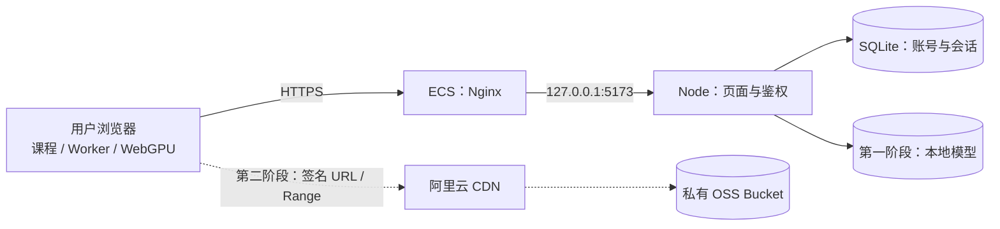

# LLM 教学平台阿里云部署手册

日期：2026-10-25  
对应项目：`how-llms-work`  
部署基线：Ubuntu 24.04 LTS、Node.js 24 LTS、Nginx、SQLite  
文档状态：依据现有代码核对的操作方案；未连接或操作实际阿里云资源。

在 `api.garryai.icu` 上与根路径 New API、`/api/*` 以及 `/how-image-models-work/` 同时部署时，不要使用本文的整站 `location /`。使用仓库里的 `Dockerfile` 和 `deploy/nginx-how-LLM-works.location.conf`，公开前缀固定为大小写敏感的 `/how-LLM-works/`，并由代理保留该前缀。

## 1. 部署方案与当前边界

第一阶段将现有前后端放到一台 ECS 上，由 Nginx 提供 HTTPS，再转发到 Node 服务。前端已经是构建后的 HTML、JS、CSS、Worker 与 WASM，无需运行 `npm run build`，当前也无需安装 npm 运行依赖。模型推理发生在用户浏览器中，ECS 不需要 GPU。

第二阶段将模型迁到私有 OSS，并通过阿里云 CDN 分发。服务器继续负责账户和下载授权。当前没有 CDN 签名接口和前端续签实现，第二阶段属于待开发工作，不能仅靠控制台设置完成。



本手册示例域名为 `learn.example.com`，服务器公网地址写作 `ECS_IP`。执行前替换这两项；第二阶段模型域名为 `models.example.com`。命令分别注明本机与服务器环境。SSH 示例使用有 sudo 权限的 `ubuntu` 用户，实际用户名以 ECS 镜像及控制台为准。

## 2. 阿里云资源准备

### 2.1 ECS 采购起点

| 配置 | 第一阶段建议 | 原因 |
|---|---|---|
| 实例 | 通用 CPU 实例，2 vCPU / 4 GB 内存 | 页面服务、SQLite、密码哈希 |
| 操作系统 | Ubuntu 24.04 LTS，x86_64 | 便于按本文安装 |
| 系统盘 | 40 GB SSD 类云盘起步 | 系统、模型、日志、发布版本和备份 |
| GPU | 不需要 | WebGPU 推理在用户设备运行 |
| 公网出口 | 测试期可从 5 Mbps 起步 | 仅用于验证流程；不适合多人下载模型 |
| 数据存储 | 单实例 SQLite | 当前鉴权实现已使用 SQLite |

以上是工程选型建议，未经线上压测，不代表可承载的并发数。正式对外服务应接入模型 CDN，避免 ECS 出口成为瓶颈。

权重精确大小为 1,706,030,600 字节。在独占 5 Mbps 出口、没有额外开销的理想条件下，传完权重约需 45.5 分钟；多人分享出口时更慢。这里是数学估算，不是实测。1,000 次完整下载的权重流量约为 1.706 TB，另计分词器、网页和重试流量。

### 2.2 域名、地域与安全组

1. 在阿里云控制台创建 ECS，选择靠近目标用户的地域。
2. 使用密钥登录，保留自己的 SSH 私钥。
3. 为 ECS 安全组添加入方向规则：

| 端口 | 来源 | 用途 |
|---|---|---|
| TCP 22 | 自己的固定公网 IP `/32`，或受控管理网络 | SSH |
| TCP 80 | 公网 | HTTPS 跳转与证书验证 |
| TCP 443 | 公网 | 网站访问 |
| TCP 5173 | 不开放 | 仅本机 Nginx 访问 Node |

4. 在域名 DNS 中添加 `learn` 的 A 记录，记录值为 ECS 公网 IP。
5. 若配置 AAAA 记录，必须同时确保 IPv6 网络及 Nginx 正确可达，否则先不要添加。
6. 中国内地网站按阿里云备案流程准备域名备案；阿里云 CDN 的加速区域包含中国内地时，域名必须完成 ICP 备案。[cite:1]

主站第一阶段直接解析到 ECS，不接全站 CDN，便于保持鉴权与真实 IP 链路清晰。

## 3. 安装服务器环境

通过本机终端连接服务器：

```bash
ssh ubuntu@ECS_IP
```

以下在 Ubuntu ECS 上执行：

```bash
sudo apt update
sudo apt install -y nginx curl ca-certificates python3 sqlite3 certbot
```

安装 Node.js 24 LTS。建议从 Node 官方下载页面选择当前 24.x Linux x64 版本，核验校验和后安装到系统路径。若使用 NodeSource 软件仓库，可按其官方说明安装；以下是相应命令，先查看下载的仓库初始化脚本，再以 sudo 执行：

```bash
curl -fsSL https://deb.nodesource.com/setup_24.x -o /tmp/nodesource-setup.sh
less /tmp/nodesource-setup.sh
sudo bash /tmp/nodesource-setup.sh
sudo apt install -y nodejs
node --version
command -v node
node --input-type=module -e "import { DatabaseSync } from 'node:sqlite'; const db = new DatabaseSync(':memory:'); console.log(db.prepare('SELECT 1 AS ok').get()); db.close();"
```

最后一条应输出 `ok: 1`。`node:sqlite` 的实验性提示本身不等于启动失败。本地核对环境为 Node v24.10.0；服务器选择当前受支持的 24.x 修订版，完成验收后记录准确版本。本文 systemd 模板假定 Node 路径为 `/usr/bin/node`，若不同则替换。

创建服务账户和数据目录。全新 ECS 执行一次：

```bash
sudo useradd --system --user-group --home-dir /var/lib/how-llms-work --shell /usr/sbin/nologin llmapp
sudo install -d -m 0755 /opt/how-llms-work/releases
sudo install -d -o llmapp -g llmapp -m 0700 /var/lib/how-llms-work
sudo install -d -o llmapp -g llmapp -m 0700 /var/lib/how-llms-work/model
sudo install -d -o llmapp -g llmapp -m 0700 /var/backups/how-llms-work
sudo install -d -m 0755 /var/www/letsencrypt
```

## 4. 上传现有前后端

在 Mac 本机执行：

```bash
tar -C "/Users/bytedance/Desktop/AI测试" -czf /tmp/how-llms-work-release.tar.gz --exclude='.DS_Store' --exclude='node_modules' --exclude='.git' how-llms-work
scp /tmp/how-llms-work-release.tar.gz ubuntu@ECS_IP:/tmp/
```

该包包含约 1.6 GiB 的完整模型，上传时间取决于本机上行速度。不要上传本机账号数据库。数据库位于静态项目目录之外，因此上述打包不会带上本机用户和会话。

返回 ECS，创建首次发布目录。后续发布使用新的目录名，不覆盖正在运行的版本：

```bash
sudo install -d -m 0755 /opt/how-llms-work/releases/20261025-01
sudo tar -xzf /tmp/how-llms-work-release.tar.gz -C /opt/how-llms-work/releases/20261025-01 --strip-components=1
sudo cp -a /opt/how-llms-work/releases/20261025-01/model/. /var/lib/how-llms-work/model/
sudo chown -R llmapp:llmapp /var/lib/how-llms-work
sudo chmod -R go-rwx /var/lib/how-llms-work
sudo ln -s /opt/how-llms-work/releases/20261025-01 /opt/how-llms-work/current
```

首次启动会创建新的用户库，正式用户需要重新注册。本机测试账号不会自动迁移。

如果需要迁移已有真实账号，应另行使用 SQLite 一致性备份迁移数据库，并撤销旧会话；不要直接复制运行中的单个 SQLite 文件。

## 5. 发布副本的两项修改

### 5.1 修复反向代理后的 IP 限流

当前 `auth.mjs` 使用 `req.socket.remoteAddress`。Nginx 反代后，该值通常为 `127.0.0.1`，所有用户会共用 IP 限流额度。

编辑 ECS 上的发布副本：

```bash
sudo nano /opt/how-llms-work/releases/20261025-01/auth.mjs
```

将：

```js
const ip = req.socket.remoteAddress || 'unknown';
```

替换为：

```js
const peer = req.socket.remoteAddress || '';
const trustProxy = process.env.TRUST_LOCAL_PROXY === '1'
  && ['127.0.0.1', '::1', '::ffff:127.0.0.1'].includes(peer);
const realIp = req.headers['x-real-ip'];
const ip = trustProxy && typeof realIp === 'string' && realIp
  ? realIp
  : peer || 'unknown';
```

该策略只适用于本手册的“浏览器直接访问 Nginx，Nginx 转发到本机 Node”拓扑。Nginx 必须覆盖 `X-Real-IP`，Node 继续只监听回环地址。后续主站接入 CDN、负载均衡或其他代理时，应重新定义可信代理链。

`TRUST_LOCAL_PROXY` 是这段改动新增的配置，原代码不识别它。

### 5.2 禁用参考站模型兜底

当前缺少模型时会向参考站代理下载。正式部署使用已上传的完整自有模型，不应依赖这个兜底。

编辑 `server.mjs`，找到：

```js
return proxyModel(req, res, relative);
```

替换为：

```js
return error(res, 503, 'Model resource unavailable');
```

保留原有合法路径校验。这样缺文件会明确失败，不会自动请求参考站。未使用的代理函数后续可清理；此修改只关闭模型兜底，页面中的外部字体或图片仍需另外检查。

完成后执行：

```bash
node --check /opt/how-llms-work/current/auth.mjs
node --check /opt/how-llms-work/current/server.mjs
stat -c '%s' /var/lib/how-llms-work/model/model.safetensors
```

最后一条应为 `1706030600`。字节数不能替代哈希验证：同时对比本机与服务器 `model.safetensors` 的 SHA-256。本机用 `shasum -a 256`，服务器用 `sha256sum`。

## 6. 用 systemd 常驻运行

创建 `/etc/how-llms-work.env`：

```dotenv
PORT=5173
PUBLIC_ORIGIN=https://learn.example.com
AUTH_DATA_DIR=/var/lib/how-llms-work
MODEL_DIR=/var/lib/how-llms-work/model
TRUST_LOCAL_PROXY=1
NODE_ENV=production
```

`PUBLIC_ORIGIN` 必须和浏览器地址一致，不含尾部斜杠、不含路径。它决定写接口 Origin 校验和 Cookie 的 Secure 属性。设置后不要通过公网 HTTP 注册登录，应等 HTTPS 完成。

环境文件权限：

```bash
sudo chmod 0600 /etc/how-llms-work.env
```

创建 `/etc/systemd/system/how-llms-work.service`：

```ini
[Unit]
Description=How LLMs Work
After=network.target

[Service]
Type=simple
User=llmapp
Group=llmapp
WorkingDirectory=/opt/how-llms-work/current
EnvironmentFile=/etc/how-llms-work.env
ExecStart=/usr/bin/node /opt/how-llms-work/current/server.mjs
Restart=on-failure
RestartSec=3
UMask=0077
NoNewPrivileges=true
PrivateTmp=true
ProtectSystem=strict
ProtectHome=true
ReadWritePaths=/var/lib/how-llms-work
StandardOutput=journal
StandardError=journal

[Install]
WantedBy=multi-user.target
```

启动并检查：

```bash
sudo systemctl daemon-reload
sudo systemctl enable --now how-llms-work
sudo systemctl status how-llms-work --no-pager
curl --fail http://127.0.0.1:5173/health
```

应得到 `status: "ok"`、`modelLocal: true`。现有 health 的 `modelSource` 文案可能仍提到参考站兜底；以第五节修改后的实际行为为准。该接口不能证明模型已经成功生成回答。

## 7. 配置 HTTPS 和 Nginx

### 7.1 先准备证书验证入口

在 `/etc/nginx/sites-available/how-llms-work` 写入以下临时配置：

```nginx
server {
    listen 80;
    server_name learn.example.com;

    location ^~ /.well-known/acme-challenge/ {
        root /var/www/letsencrypt;
    }
    location / {
        return 503;
    }
}
```

全新默认 Nginx 环境启用站点：

```bash
sudo ln -s /etc/nginx/sites-available/how-llms-work /etc/nginx/sites-enabled/how-llms-work
sudo nginx -t
sudo systemctl reload nginx
```

DNS 已解析到本机且 80 端口可达后，申请证书：

```bash
sudo certbot certonly --webroot -w /var/www/letsencrypt -d learn.example.com
```

也可使用阿里云证书服务签发的证书，下载 Nginx 格式后上传；此时下节替换证书文件路径，并配置相应续期流程。若现有服务器已承载其他网站，保留其他站点配置，不要覆盖它们。

### 7.2 替换为正式配置

将该站点配置替换为：

```nginx
server {
    listen 80;
    server_name learn.example.com;
    location ^~ /.well-known/acme-challenge/ {
        root /var/www/letsencrypt;
    }
    location / {
        return 301 https://learn.example.com$request_uri;
    }
}

server {
    listen 443 ssl;
    server_name learn.example.com;
    ssl_certificate /etc/letsencrypt/live/learn.example.com/fullchain.pem;
    ssl_certificate_key /etc/letsencrypt/live/learn.example.com/privkey.pem;
    ssl_protocols TLSv1.2 TLSv1.3;
    client_max_body_size 8k;

    location / {
        proxy_pass http://127.0.0.1:5173;
        proxy_http_version 1.1;
        proxy_set_header Host $host;
        proxy_set_header X-Forwarded-Proto https;
        proxy_set_header X-Real-IP $remote_addr;
        proxy_set_header X-Forwarded-For $remote_addr;
        proxy_connect_timeout 5s;
        proxy_read_timeout 300s;
        proxy_send_timeout 300s;
        proxy_buffering off;
        proxy_cache off;
    }
}
```

`proxy_read_timeout` 是两次上游读取之间的等待上限，不是整次模型下载时长。Node 以流方式返回文件，避免将权重整体读入服务器内存。

所有页面和资源都交给 Node 判断权限，不给项目目录配置 `root` 或直接静态访问。否则可能绕开鉴权或公开后端文件。

Node 已设置 COOP、COEP、CORP，反代透传即可，不重复添加。全站保持不使用共享缓存，特别是 `/api/auth/*`、账户页和受保护课程。

启用并验证证书续期：

```bash
sudo nginx -t
sudo systemctl reload nginx
sudo install -d /etc/letsencrypt/renewal-hooks/deploy
sudo sh -c 'printf "#!/bin/sh\nsystemctl reload nginx\n" > /etc/letsencrypt/renewal-hooks/deploy/reload-nginx'
sudo chmod 0755 /etc/letsencrypt/renewal-hooks/deploy/reload-nginx
sudo certbot renew --dry-run
systemctl list-timers --all | grep certbot
```

确认续期定时任务存在；若系统没有相应 timer，应按证书工具说明补充定时任务。`--dry-run` 验证续期，不代表真实证书已续签。

此时访问：

```text
https://learn.example.com/zh/chapters/overview
```

首次进入登录页，先注册，再登录。

## 8. 现有鉴权逻辑

| 环节 | 当前行为 |
|---|---|
| 注册 | 昵称、邮箱、密码；邮箱唯一；密码 8–128 字符 |
| 注册结果 | 仅创建账号，不自动登录 |
| 登录 | 仅已有账号可登录；错误密码或不存在的账号返回 401 |
| 密码保存 | 随机盐 + scrypt，数据库不保存明文 |
| 会话 | 32 字节随机 token；数据库只保存 SHA-256 摘要 |
| Cookie | HttpOnly、SameSite=Lax、Path=/；本手册 HTTPS 环境启用 Secure |
| 有效期 | 固定 7 天；退出撤销当前会话 |
| 写接口 | 精确 Origin + CSRF token + JSON 请求 |
| 页面权限 | 匿名课程请求跳转登录 |
| 资源权限 | 模型、Worker、WASM、课程脚本匿名请求返回 401 |
| 数据持久化 | `/var/lib/how-llms-work/auth.sqlite`，重启后保留 |

当前未实现邮箱验证、邮件找回密码、管理后台和分级课程权限。邮箱只是账号标识，不代表已验证邮箱归属。

当前 IP 和邮箱限流存放在单进程内存中，服务重启后清空，适合起步单实例。注册 IP 限额 10 次/15 分钟，登录 IP 限额 40 次/15 分钟，邮箱登录限额 15 次/15 分钟；共享办公网络仍可能共享出口 IP，应根据试用情况调整。多实例时迁移到共享限流与共享数据库。

## 9. 第二阶段：阿里云 OSS 与 CDN

### 9.1 控制台设置

推荐创建和 ECS 同地域、同账号的私有 OSS Bucket，上传模型目录中的全部必要文件，采用不可变版本路径：

```text
models/qwen3.5-0.8b-bf16/20261025-01/model.safetensors
models/qwen3.5-0.8b-bf16/20261025-01/config.json
models/qwen3.5-0.8b-bf16/20261025-01/tokenizer.json
models/qwen3.5-0.8b-bf16/20261025-01/其他运行时所需文件
```

最后一行描述文件清单要求，不是实际对象名。不要只上传权重；以运行时请求记录及本地 `model/` 文件清单为准。

| 控制台配置 | 建议 |
|---|---|
| CDN 加速域名 | `models.example.com` |
| 业务类型 | 与大文件下载分发相适应的类型，以控制台选项为准 |
| 源站类型 | OSS 域名，选择目标 Bucket |
| 回源 HOST | 目标 OSS Bucket 域名 |
| OSS 私有 Bucket 回源 | 开启，同账号回源，按控制台授权 |
| 客户端 HTTPS | 配置模型域名证书，强制 HTTPS |
| Range 回源 | 开启 |
| 模型对象缓存 | 不可变版本目录，初始建议 30 天 |
| 内容转换 | 权重关闭 gzip/br、页面优化和字节内容变换 |
| URL 鉴权 | 开启阿里云 CDN A 方式；服务端生成相匹配的签名 |
| DNS | `models` CNAME 指向 CDN 分配的地址 |
| 流量告警 | 在云监控设置流量与费用相关告警 |

阿里云明确区分“CDN 访问私有 OSS 的回源授权”和“用户访问 CDN 的授权”：仅开启私有 Bucket 回源，会让 CDN 获得读取权限，但不会自动验证登录用户。必须再开启 CDN URL 鉴权。[cite:1][cite:2]

不要把 OSS 签名 URL 当作 CDN 签名 URL 使用，也不要把阿里云 AccessKey 发给浏览器。使用同账号回源的官方授权流程；下载签名密钥只在后端保管。

### 9.2 需要实现的应用改造

1. 新增 `POST /api/model-access`，检查会话、Origin、CSRF 和资源允许名单。
2. 后端按阿里云 CDN 官方 A 方式规则，对每个具体模型文件生成短期签名 URL，返回文件路径、大小、SHA-256 和有效期。
3. 前端实际模型加载器接入逐文件 URL 映射；配置、分词器、权重和 Range 请求统一使用授权地址。
4. 支持提前续签和到期后的原 Range 重试；会话失效返回 401，停止新下载。
5. CDN 对缓存命中请求也要执行验签；预热后验证裸地址和错误签名依然拒绝。
6. 完整验证后切换模型来源，保留已验收的本地版本作受鉴权回退。

阿里云 A 方式使用共享主/备 KEY，与此前通用文档中的“公钥/私钥”示例不同。本项目采用阿里云方案时，以官方规则及官方示例为准，不复用其他 CDN 的签名格式。[cite:2]

签名初始有效期可设置为 30 分钟，这是工程建议。权重慢速下载可能超过有效期，因此上线前必须验证阿里云实际对进行中下载、新 Range、断线重试的处理，不套用其他 CDN 厂商的过期行为。

### 9.3 跨域响应

CDN 模型响应配置：

```http
Access-Control-Allow-Origin: https://learn.example.com
Access-Control-Allow-Methods: GET, HEAD, OPTIONS
Access-Control-Allow-Headers: Range
Access-Control-Expose-Headers: Content-Length, Content-Range, Accept-Ranges, ETag
Cross-Origin-Resource-Policy: cross-origin
```

前端使用 CORS 下载并设置 `credentials: "omit"`，无需跨域传主站会话 Cookie。OPTIONS 只返回允许信息，不返回模型内容；实际 GET/HEAD 必须验签。验证真实浏览器是否发起预检，以及厂商的 OPTIONS 鉴权行为。

仅在 OSS 设置 CORS 可能受 CDN 缓存影响，阿里云建议在 CDN 出站响应头层配置跨域响应。[cite:1]

CDN 内部缓存与浏览器缓存策略分开设置；账户、签名清单保持 `no-store`。不得为了模型缓存而对主站全站开启公共缓存，也不得简单关闭 URL 鉴权排查问题。

下载签名不具备文件回收能力。退出后主站会话立即失效，但已签发 CDN URL 通常仍有剩余有效期，已下载到用户设备的模型无法收回。

## 10. 上线验收

| 检查 | 通过标准 |
|---|---|
| HTTPS | 证书有效，HTTP 跳转 HTTPS，续期演练成功 |
| 匿名访问 | 课程转登录，模型/Worker/WASM/脚本返回 401 |
| 注册登录 | 注册不自动登录；正确凭证登录；重复邮箱拒绝 |
| Secure Cookie | 浏览器 Application 面板显示 Secure、HttpOnly |
| CSRF | 错误 Origin 或缺 token 的写请求返回 403 |
| 重启持久化 | 重启 systemd 后已有账号可登录 |
| IP 限流 | 独立出口用户不因 Nginx 地址共享额度 |
| 文件保护 | `/auth.mjs`、`/server.mjs`、数据库无法公网下载 |
| 跨源隔离 | 控制台 `window.crossOriginIsolated` 为 true |
| WebGPU | 目标浏览器 `navigator.gpu` 可用 |
| 模型运行 | 加载完整权重，实际生成回答；J-Space 可观察运行 |
| 中英切换 | 全局菜单、右侧“动手试试”、注册及账户页面同步 |
| CDN 第二阶段 | 签名正确可下载；裸地址、篡改签名、超期地址拒绝 |
| Range | 请求 `bytes=0-1023` 返回 206、1024 字节、正确总长 |

本地现有记录只证明部分运行链路通过，不能替代正式域名下的真实生成验收。使用支持 WebGPU 的桌面 Chrome/Edge，并验证实际用户设备的内存余量。

无需登录的基础检查：

```bash
curl -I https://learn.example.com/auth/login
curl -i https://learn.example.com/api/model/model.safetensors
```

第二条预期 401。登录后的大文件与 Range 检查在浏览器 Network 面板完成，避免将会话 Cookie 和签名写入共享日志。

## 11. 日常维护、备份与更新

常用服务器命令：

```bash
sudo journalctl -u how-llms-work -n 100 --no-pager
sudo journalctl -u how-llms-work -f
sudo systemctl restart how-llms-work
sudo systemctl status how-llms-work --no-pager
sudo tail -n 100 /var/log/nginx/error.log
```

每日使用 SQLite 一致性备份，文件名自动包含 UTC 时间：

```bash
sudo -u llmapp python3 - <<'PY'
import datetime
import pathlib
import sqlite3

stamp = datetime.datetime.now(datetime.timezone.utc).strftime("%Y%m%dT%H%M%S%fZ")
dest = pathlib.Path("/var/backups/how-llms-work") / f"auth-{stamp}.sqlite"
source = sqlite3.connect("file:/var/lib/how-llms-work/auth.sqlite?mode=ro", uri=True)
backup = sqlite3.connect(dest)
try:
    source.backup(backup)
    result = backup.execute("PRAGMA integrity_check").fetchone()[0]
    if result != "ok":
        raise RuntimeError(result)
finally:
    backup.close()
    source.close()
dest.chmod(0o600)
print(dest)
PY
```

验证脚本后将其加入服务器定时任务，初期每日一次，并将加密备份副本保存到独立私有存储。ECS 同机备份不能防止整机或整盘损坏。WAL 模式下不要以普通 `cp auth.sqlite` 代替一致备份。

恢复时停止服务，恢复一致数据库，处理旧 WAL/SHM，恢复目录与文件权限，清空 sessions 让所有用户重新登录，然后启动并验收。清空会话可避免旧备份重新激活已经退出的登录状态。

更新使用新的 `releases/<版本>` 目录，保留同一个外部数据目录。完成第五节必要改动及语法检查后切换 `current` 软链接并重启。回滚切回已验收版本；不要把未修复代理 IP 的本地原始版本作为生产回滚目标。

## 12. 常见故障

| 现象 | 优先检查 |
|---|---|
| 502 Bad Gateway | systemd 服务、Node 路径、SQLite 初始化、5173 是否监听 |
| 注册/登录 403 | PUBLIC_ORIGIN 与地址栏完全一致；CSRF；是否仍用 HTTP |
| 多个用户突然 429 | 第五节 IP 改动与 X-Real-IP 是否生效；是否共享真实出口 |
| 页面正常但模型报错 | WebGPU、crossOriginIsolated、Worker/WASM 响应、完整模型文件 |
| 模型下载极慢 | ECS 公网出口；多人竞争；尽快完成第二阶段 |
| CDN 403 | CDN 签名与 OSS 回源签名是否混用；主 KEY、时间、路径、有效期 |
| CDN 有时成功有时失败 | 私有回源权限、回源 HOST；热缓存可能掩盖回源错误 |
| CDN 跨域错误 | CDN 出站 CORS、CORP、OPTIONS、错误响应头 |
| 重启后账号丢失 | AUTH_DATA_DIR 是否一致；是否误把数据库放在发布目录 |

## 13. 参考与交付范围

项目依据：本地 `package.json`、`server.mjs`、`auth.mjs`、`README.md` 和已有《LLM教学平台-技术实施文档》。本手册未修改项目代码，部署副本修改需按第五节实际执行。

当前前端复用了参考站公开发布的构建产物，不等于获得原始源码及对外分发授权。正式公开发布前，按项目 README 确认课程、构建产物及模型使用与分发条件。

下列来源用于阿里云产品配置事实。硬件、带宽、TTL 和保留周期均为本项目工程建议，不是阿里云容量保证。

- <a id="cite-1"></a>[cite:1] 阿里云：通过 CDN 加速访问 OSS。包括备案、CNAME、私有回源、Range、CORS、回源 HOST 及 CDN URL 鉴权边界。https://help.aliyun.com/zh/oss/user-guide/cdn-acceleration
- <a id="cite-2"></a>[cite:2] 阿里云：在 CDN 控制台配置 OSS 加速，含 A 方式 URL 鉴权。https://help.aliyun.com/zh/cdn/use-cases/accelerate-the-retrieval-of-resources-from-an-oss-bucket-in-the-alibaba-cloud-cdn-console
- Node 官方下载：https://nodejs.org/en/download
- NodeSource 安装说明：https://github.com/nodesource/distributions

本文提供实际部署操作与第二阶段开发边界，不代表 ECS、证书、OSS、CDN 或公网验收已完成。
